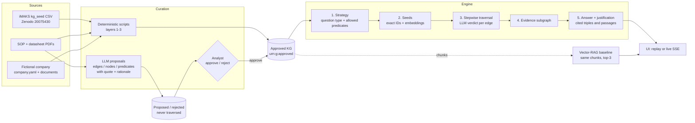

# Graph Anchor

**A human-curated enterprise knowledge graph is the grounding anchor for LLM answers: the model only proposes, analysts approve, and every answer ships with the graph path that led to it.**

IBM Responsible AI Hackathon (WU & UNIVIE), 24 October 2026. Live demo: <https://rai-hackathon.bbger.at>

## Why

Assistants in companies usually answer from text chunks that are *semantically similar* to the question. They ignore how
knowledge items *relate*: two SOPs may both mention "conveyor", but only one is linked to the station that failed, and a
datasheet may contradict an SOP. Graph Anchor builds the context by **traversing a curated graph** instead.

Responsible-AI angle:

- **Reliability.** LLMs never write into the graph that answers are built from. Proposals wait in a separate named graph until an analyst approves them. The engine walks only `urn:g:approved`. Contradictions between documents are surfaced, not resolved silently.
- **Transparency.** Each answer carries its strategy (allowed predicates), a verdict for every traversal step, the cited triples, the document passages and the *evidence subgraph*. We show which knowledge the model was given. We do not claim to know what it used internally.

## What you see

1. **The twin:** the graph of a fictional company that runs the iMAKS plant, with its documents attached.
2. **Ask:** pick one of three questions (or type one in live mode). The engine first shows its traversal strategy.
3. **Traverse:** the run plays step by step; each hop shows the LLM verdict (follow / prune / enough evidence).
4. **Answer:** justification, cited triples, passages, and a contradiction badge where an SOP conflicts with a datasheet.
5. **Contrast:** the same question through plain vector RAG (top-k = 3).
6. **Curate:** the LLM proposes edges, nodes and predicates; an analyst approves or rejects.
7. **Roadmap:** right-sized on-prem models (screen is labelled as not running today).

## Run it locally

Python 3.12+ with [uv](https://docs.astral.sh/uv/), Node 20+.

```bash
uv sync --extra kg --extra engine --extra api
uv run pytest -q

# web UI, offline replay of the stored runs (no API, no LLM, no network)
cd web && npm ci && VITE_DATA=static npm run build && npm run preview     # http://127.0.0.1:5180

# full app: API + built UI + live mode
cp .env.example .env            # set LITELLM_BASE_URL, LITELLM_API_KEY, RAI_MODEL, RAI_INVITE_CODES
uv run uvicorn api.main:create_app --factory --port 17080               # http://127.0.0.1:17080
```

Replay needs no key. Live questions need an invitation code (`RAI_INVITE_CODES`, header `X-Invite-Code`).
Frontend work: see [web/FRONTEND.md](web/FRONTEND.md). Live mode, `kg.propose` and re-running the engine need an OpenAI-compatible gateway (we use a
LiteLLM gateway in front of OpenRouter). Docker: `docker compose -f deploy/compose.yml up -d --build`.

Rebuild the graph and the demo runs:

```bash
uv run python -m kg.build                                   # downloads iMAKS on first use, writes data/graph/kg.trig
uv run python -m kg.propose openai/claude-sonnet-4-6        # optional: new LLM proposals (needs the gateway)
uv run python -m engine.run "<question>" --out runs/<id>.jsonl
```

## Architecture



Four graph layers; only layer 4 uses an LLM, and its output is never used for answers before approval:

| Layer | Source | How | Status |
|---|---|---|---|
| 1 | iMAKS `nodes.csv`, `edges.csv` | CSV to RDF script (115 nodes, 319 edges) | approved |
| 2 | 4 SOPs, 3 datasheets, `ground_truth.csv` | PDF to `Document`/`Chunk`; `mentions` only by exact ID match; 86 `Rule` nodes | approved |
| 3 | `data/company.yaml`, 2 company documents | Kelvara Packaging GmbH, suppliers, sensor models, orders, roles | approved |
| 4 | LLM reading chunks | edge, node and predicate proposals | proposed until an analyst decides |

Every edge has an ID (`sha1(s|p|o)[:12]`, one function in `contracts/ids.py`) and a provenance row in
`data/graph/provenance.jsonl` (source, creator, status). Citations join on IDs, never on rendered text.

Repo layout: `contracts/` (Pydantic models, ID function, `GraphStore`, fixtures; the single source of truth),
`kg/` (graph build and proposals), `engine/` (traversal), `api/` (FastAPI + SSE), `web/` (React + Vite + Cytoscape),
`runs/` (stored runs as JSONL events), `deploy/`.

## What is real and what is mocked

**Real**

- The graph: layers 1-3 are built by deterministic scripts from the iMAKS data and the company YAML. Layer-4 proposals come from an LLM with a verbatim-quote check and a second verification pass.
- The engine: strategy, seeds, per-step LLM verdicts, answer, evidence subgraph and the RAG baseline are computed by `engine/`. The three demo runs in `runs/demo-*.jsonl` are real engine output (model `openai/mistral-large-4-openrouter`), replayed so the pitch needs no network.
- Live mode runs the same engine on a free-text question and streams the same events.
- Live chat is multi-turn: the server keeps the last 3 turns (question, true answer, evidence node ids) per `X-Chat-Session` in memory and passes them to the engine, so a follow-up like "Who supplies it?" resolves. The turns go into the strategy, step and answer prompts; the previous answer's entities become extra seeds. A chat-canary answer is stored with the true fact, never the planted one. No persistence; "New chat" in the UI starts a fresh session.

**Mocked or limited (and labelled in the UI)**

- `runs/mock-canary-chat.jsonl` is a hand-written run, tagged **Mock**. It is a canary for the chat view, not engine output.
- **Curation persistence.** In static (offline) mode, decisions stay in the browser. With the API, decisions are written to `data/proposals.json` on the server and move the edge between named graphs in memory. There is no database, no auth, no audit trail, and a restart rebuilds the graph from `kg.build`. Approved *predicate* proposals are only recorded: the ontology is frozen today.
- The vector-RAG baseline is real (same chunks, top-3), but we make no claim of general superiority over RAG: the demo questions were chosen to show the difference, and we ran no quantitative evaluation (accuracy and faithfulness would be the next thing to measure).
- The Roadmap screen shows plans only.
- One of the six stored proposals (`SOP-001-s3 contradicts DS-THERM-2200-s1`) was seeded by an analyst (`analyst-seed`) so the curation example is guaranteed; the other five came from the LLM. `SOP-002-s6 contradicts DS-ELEC-3300-s1` was approved by the coordinator acting as analyst.
- No tracing or logging stack, no parallel sub-agents.

## Data sources

- **iMAKS** dataset, Zenodo record [20075430](https://zenodo.org/records/20075430) (`iMAKS_dataset.zip`, ~20 MB): structured seed graph (`kg_seed/`), 4 SOP PDFs, 3 datasheet PDFs. Downloaded by `kg/download.py` into `data/raw/imaks/` (gitignored). Check the record for its licence before redistributing.
- **Fictional company:** Kelvara Packaging GmbH, its customers (Velora Foods AG, Nordmilch eG), the service provider, production orders and two company documents are invented. All company data is synthetic. The supplier names ThermoSense GmbH, MechSens Italia S.r.l. and ElectroMeasure AG are the vendors named in the iMAKS datasheets.

## Relation to the bachelor thesis

The idea carries over the thesis *"Reducing Hallucinations in LLM-Based QA through Hybrid Multi-Agent KG Traversal"*
to an enterprise setting. The thesis argues for a **curated source instead of LLM extraction** (Wikidata); here the
curated source is an analyst-approved graph. The traversal loop (seeds, frontier, relevance check, stepwise subgraph
growth), the paired answer-plus-justification output and the event-stream UI are ported from the thesis code. New for
the hackathon: the per-question **strategy step** (allowed predicates), an **LLM verdict at every step**, the explicit
**evidence subgraph**, and the **curation loop**.

## Roadmap

- **Right-sized on-prem models.** Route by task: a large model for strategy and the final answer, small ones (e.g. Ministral 3B/8B/14B) for step verdicts, escalating to the large one when a contradiction appears. The routing ladder is sketched in the UI.
- **IBM Granite.** Models are called through LiteLLM, so switching to Granite on watsonx is a configuration change (`RAI_MODEL`). We did not have watsonx credentials today and have not evaluated Granite.
- **Local and open-weight models.** Run the whole stack in-house so no company data leaves the network.
- **Access-aware traversal.** Restrict edges and chunks to what the asking user may see (the iMAKS data already models who is authorised for which zone).
- **A real curation backend:** persistence, roles, audit trail, ontology changes for approved predicates, and re-checking answers when the graph changes.
- **Evaluation.** Accuracy and faithfulness against vector RAG over many questions; the thesis' parallel multi-agent traversal as a further step.

## More

- Design: [docs/superpowers/specs/2026-10-24-graph-anchor-design.md](docs/superpowers/specs/2026-10-24-graph-anchor-design.md)
- Plan: [docs/superpowers/plans/2026-10-24-graph-anchor.md](docs/superpowers/plans/2026-10-24-graph-anchor.md)
- Demo-question check against the real graph: [docs/superpowers/demo-question-check.md](docs/superpowers/demo-question-check.md)
